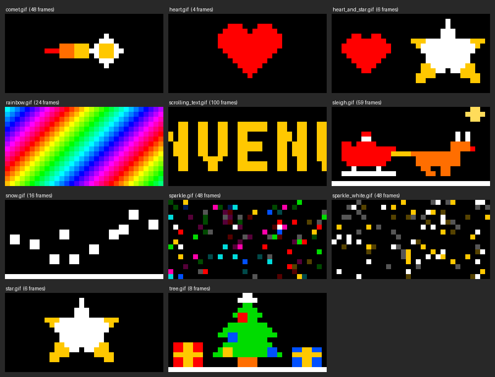

# Example animations for the 32 x 16 net light

Eleven animations drawn at 32 x 16, one image pixel per LED, for the net light with product
ID `0x0071`. They are original drawings made for this repository.



| File | Frames | What it shows |
| --- | --- | --- |
| `heart.gif` | 12 | A red heart that beats |
| `star.gif` | 8 | A yellow star with a white core that grows and shrinks |
| `heart_and_star.gif` | 8 | Both, side by side |
| `tree.gif` | 12 | A Christmas tree with blinking balls and two presents |
| `comet.gif` | 48 | A comet that crosses from left to right |
| `sleigh.gif` | 60 | A sleigh and a reindeer that cross under the moon |
| `rainbow.gif` | 24 | Diagonal rainbow bands that move sideways |
| `snow.gif` | 16 | Big snowflakes falling at two speeds |
| `sparkle.gif` | 48 | Many colored lights that flash at random places |
| `sparkle_white.gif` | 48 | The same in white and gold |
| `scrolling_text.gif` | 100 | Bold scrolling text (the `show_text` service does this for any text) |

## Use them in Home Assistant

Copy the files to a folder Home Assistant may read, for example `/config/www/net/`, then:

```yaml
action: surplife_ble.upload_animation
target:
  entity_id: light.net
data:
  path: /config/www/net/heart.gif
  speed: 55
  resample: nearest
```

`resample: nearest` keeps the pixels as drawn. Speeds that look right: 45 for the tree, 55
for the heart and the star, 70 to 75 for the comet, the sleigh and the text.

## What reads well on this net

The LEDs are 10 cm apart, so from a few meters the eye sees dots, not a picture. One or two
big filled shapes in a few saturated colors read best. One-pixel lines, small details and
dark colors are lost. In testing, the heart and the star were clear at 2 m, and the tree
and the sleigh were only just recognizable.

## Make your own

`make_examples.py` builds all files. Run it from the repository root. It needs Pillow.

```bash
python examples/net_32x16/make_examples.py [output directory] [scrolling text]
```
